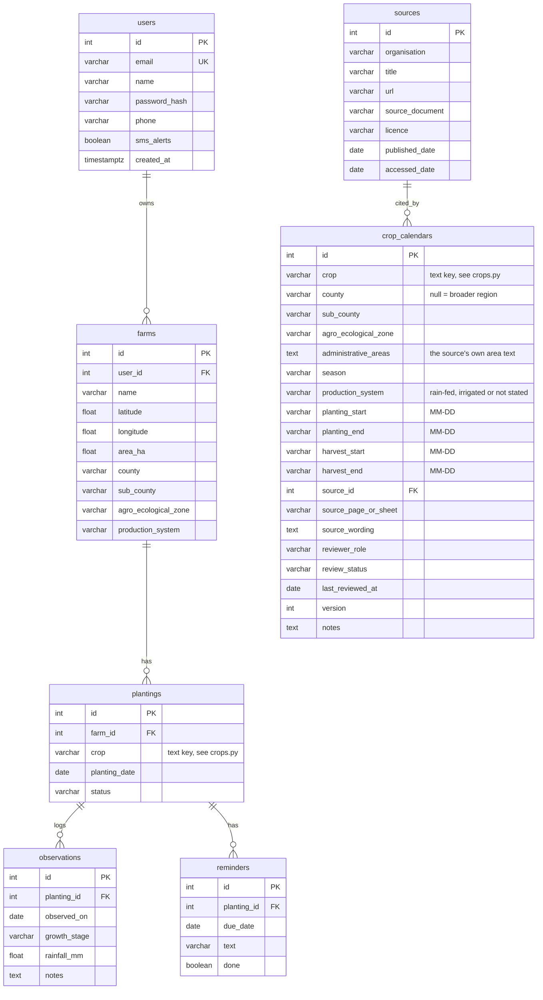

# AgriCast database (v6)

`schema.sql` is generated from `backend/app/db.py`. It was run on PostgreSQL 16 and matched what the app creates (7 tables, 5 foreign keys).
To redraw the diagram: in drawSQL create a new diagram and import `schema.sql` as PostgreSQL SQL.

## Not tables (by design in v6)
- **Crops:** reference data in `backend/app/crops.py` (base and upper temperature, growing degree days, sowing depth, spacing, water need, verification URLs). `plantings.crop` and `crop_calendars.crop` hold the crop key. A `crops` table with real foreign keys is a possible next step.
- **Weather:** cached in memory, not stored.
- **Alerts:** computed from reminders and the forecast, not stored.

## Changes needed in the drawSQL diagram to match v6
1. Add `observations` and `reminders` (both link to the planting).
2. Rename `crop_plans` to `plantings` and drop its `user_id`, `calendar_id` and `expected_harvest_date`; add `status`.
3. Remove `alerts`, `weather_records` and the `crops` table (or keep `crops` only as a note that it lives in code).
4. In `crop_calendars`: store the four window fields as `MM-DD` text, remove `source_name`, `source_url` and `source_document` (they live in `sources`), and add `source_page_or_sheet`, `source_wording` and `version`.
5. In `users`: replace `username`, `role`, `is_active`, `updated_at` with `name`, `phone`, `sms_alerts`.
6. In `farms`: `name` (not `farm_name`), `area_ha` (not `size_hectares`), add `production_system`, drop `created_at` and `updated_at`.
7. Use `SERIAL` ids and `INTEGER` foreign keys throughout, and remove `created_at` and `updated_at` from every table except `users.created_at`.
